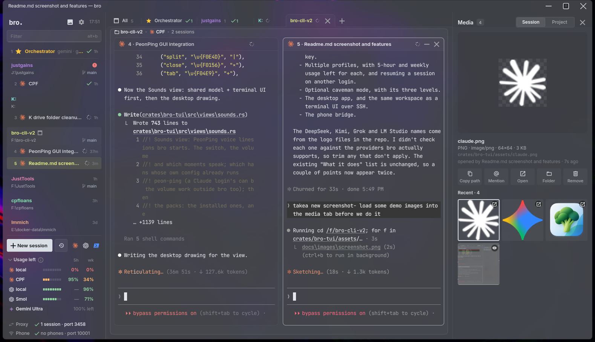

# bro

One workspace for all your coding agents (Claude Code, Codex, Pi and omp), side by side. Windows, macOS and
Linux.



## Highlights

- **Every model in your favourite harness.** Run Claude Code on Gemini, GPT, DeepSeek, Kimi, Grok, local
  LM Studio models and more, or Codex, Pi and omp on Claude. A built-in proxy translates Anthropic and
  OpenAI formats, so you keep the agent you like and pick the model per session.
- **Gemini on your Google AI subscription** or an API key, in any of the four agents
  ([docs/gemini.md](docs/gemini.md)).
- **Multiple profiles.** Several Claude, Codex and Gemini logins side by side, with 5-hour and weekly usage
  left for each. Resume a session on another login when one runs out.
- **Optional caveman mode.** Terse replies that keep every technical fact: fewer output tokens, faster
  answers. Three levels, off by default ([docs/caveman.md](docs/caveman.md)).
- **Sound packs.** PeonPing voice lines when an agent finishes or needs you, in all four agents. Browse,
  preview and install 370+ packs. MP3 packs and the volume work on every OS ([docs/sounds.md](docs/sounds.md)).
- **A beautiful desktop app, and the same workspace as a TUI.** GPU-rendered GUI on Windows, macOS and
  Linux; over SSH or with no display, `bro` opens the terminal version with the same sessions and keys.
- **On your phone.** The Just Terminal mobile and web clients connect to a built-in bridge.

## Install

**Windows** (PowerShell):

```powershell
irm https://raw.githubusercontent.com/JustSuperHuman/bro-cli/main/install.ps1 | iex
```

Or run the `…-setup.exe` from the [latest release](https://github.com/JustSuperHuman/bro-cli/releases/latest).

**macOS / Linux**:

```sh
curl -fsSL https://raw.githubusercontent.com/JustSuperHuman/bro-cli/main/install.sh | sh
```

## Use

```
bro          the desktop app
bro-cli      the same workspace in your terminal
```

Both open the folder you're in as the current project (`bro <folder>` opens another). On Windows, **bro** is in
the Start menu too. Over SSH, or with no display, `bro` opens the terminal version by itself.

Inside: `alt+n` starts an agent, `alt+p` opens the command palette, `F1` lists every key.

## Update

`bro update`, or Settings → Updates. bro also checks by itself and tells you when there's a new release.
Running the install line again works too.

## What it does

- **Runs your agents side by side**: split, zoom and switch between live sessions, grouped by project.
- **Shows who needs you**: each agent is marked working, waiting on you or done.
- **Shows pictures and videos** your agents open or make, right beside the session.
- **Switches accounts**: several Claude and Codex logins, with usage left for each.
- **Resumes anything**: pick up a past session, or move it to another login.
- **Mixes models**: a built-in proxy runs Claude Code on OpenAI-format models, and Codex, Pi and omp on Claude.
- **Reaches your phone**: the Just Terminal mobile and web clients connect to a built-in bridge.
- **An orchestrator**: one session that runs the others, hands them tasks and reports back. See
  [docs/watchdog.md](docs/watchdog.md) for keeping sessions working while you're away.
- **Claude Code agent teams**, on by default: each lead lists its teammates in the sidebar, and a team board shows
  who's doing what and the task list they share ([docs/claude-env.md](docs/claude-env.md#agent-teams)).

## More

- [Installing and updating](docs/install.md): the installer, what it puts where, building from source
- [Using bro](docs/using.md): profiles, pasting images, fonts, themes
- [The desktop app](docs/gui.md) and its keys
- [Quick Install](docs/quick-install.md): `bro install` for Git, Node.js, the agents and more
- [Gemini on your Google AI subscription](docs/gemini.md)
- [Env files](docs/env-files.md): carry your API keys to a new machine
- [Claude Code presets](docs/claude-env.md), [the bro mod for Claude Code](docs/claude-mod.md), [watchdogs](docs/watchdog.md), [caveman mode](docs/caveman.md), [sounds](docs/sounds.md)

## License

MIT
