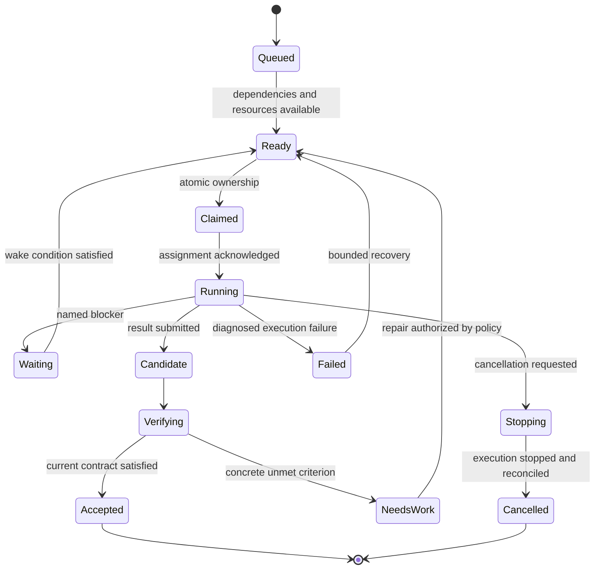

# Make Bro finish concurrent work reliably

Bro's largest opportunity is a durable execution layer that keeps each requested outcome traceable until it is verified and delivered. Its root orchestrator and project coordinators already provide useful ownership boundaries. The next step is to give their work stable task identities, explicit dependencies, and acceptance rules that runtime code enforces. Start by fixing request-to-reply attribution and ambiguous readiness or completion outcomes, then establish one complete path from assignment to verified result with a single worker. Recovery and more sophisticated scheduling can build on that foundation. The objective should be more accepted work with less user correction, measured alongside time and cost. Nothing in the available research establishes a universal team size or a promised speedup for Bro.

## Bro already coordinates agents but needs stronger task semantics

### Preserve the existing hierarchy and supervision

Bro already has a workspace orchestrator and one coordinator per project. It reuses running coordinators and carries the source harness, login, provider, model, permission settings, and browser into new project coordinators. Its scoped instruction files also prevent simultaneous launches from overwriting one another. A redesign should retain those behaviors and their tests. Adding another management layer would not address the principal gap. ([Scoped orchestration instructions](</F:/bro-cli-v2/crates/bro-core/src/orchestrator.rs:104>), [coordinator creation](</F:/bro-cli-v2/crates/bro-tui/src/app/sessions.rs:398>))

The existing tools can open and inspect sessions, send input, answer questions, read transcripts, inspect usage, schedule prompts, clear context, and record watchdog milestones. Watchdogs already have milestone states, evidence notes, bounded wakes, helper awareness, and retry backoff. Persistent schedules claim timer occurrences across processes. Session metadata and selected conversation information survive restarts. Claude team tasks expose owners and dependency relationships through a provider-specific read model. These components provide integration points for task execution. ([Orchestrator tools](</F:/bro-cli-v2/crates/bro-core/src/orchestrator.rs:146>), [watchdog plan](</F:/bro-cli-v2/crates/bro-bridge/src/watchdog/mod.rs:55>), [schedule claims](</F:/bro-cli-v2/crates/bro-bridge/src/schedule.rs:195>), [host recovery](</F:/bro-cli-v2/crates/bro-host/src/store.rs:1>), [Claude team reader](</F:/bro-cli-v2/crates/bro-core/src/agent_teams.rs:1>))

The missing common object is the work itself. `open_session.task` is optional free text delivered through terminal input. Its schema does not define a Bro task ID, dependencies, acceptance checks, resource claims, or a result contract. `taskSent` records attempted delivery. A session is an execution context; assignment and success need their own records. ([Session schema](</F:/bro-cli-v2/crates/bro-bridge/src/orchestrator/tools.rs:91>), [task delivery](</F:/bro-cli-v2/crates/bro-bridge/src/orchestrator/tools.rs:1174>))

The code observations here describe the working tree on 29 October 2026, including changes already present. The hazards below are static findings and inferred failure scenarios, except where a cited test explicitly establishes current semantics. They are not measurements of incident frequency.

### Fix attribution and outcome vocabulary first

The inbox deserves the earliest focused investigation. `pump_voice` permits submission while the orchestrator is working and can drain successive messages. Awaiting requests use a changed latest reply as their response signal. Multiple pending requests can therefore be attributed the same subsequent reply; this needs a concurrent regression case to establish the exact runtime behavior. Give every request an envelope with its origin, request ID, target intent or task, delivery sequence, and response handle. Where a harness cannot correlate turns, allow one ordinary uncorrelated request in flight and queue the rest. Keep explicit steering and answers to identified questions separate from new assignments. ([Submission path](</F:/bro-cli-v2/crates/bro-tui/src/app/voice.rs:246>), [reply attribution](</F:/bro-cli-v2/crates/bro-tui/src/app/voice.rs:282>))

Launch readiness also needs a typed outcome. The current readiness loop can time out to `Ok(None)`, and the caller can proceed with terminal paste. Return `ready`, `needs_input`, `exited`, or `timed_out` explicitly. A timed-out launch should leave a visible pending assignment, with no claim of acknowledged delivery. Compatibility heuristics may remain, but the API should identify their uncertainty. ([Readiness loop](</F:/bro-cli-v2/crates/bro-bridge/src/orchestrator/tools.rs:1079>))

`wait_for_sessions` currently treats closed sessions and sufficiently quiet nonworking sessions as settled, while its summary says tabs finished. Its detailed states retain more information, so this is an observation-contract ambiguity, not evidence that the function changes a durable task to successful. Rename the summary around observed state changes and reserve task completion for a separate result-and-acceptance path. A question, an exit, and a completed worker turn each need their own handling. ([Wait predicate and summary](</F:/bro-cli-v2/crates/bro-bridge/src/orchestrator/tools.rs:974>))

Watchdog `standDown` is currently a general stop operation: an existing test accepts it with unfinished milestones. Preserve the ability to stop. Add an explicit reason and distinguish stopped from verified complete. Likewise, reviewed should mean that a review occurred; accepted should mean the current task contract was satisfied. This avoids turning a useful cancellation operation into an accidental assertion of success. ([Update logic](</F:/bro-cli-v2/crates/bro-bridge/src/watchdog/mod.rs:389>), [existing stop semantics test](</F:/bro-cli-v2/crates/bro-bridge/src/watchdog/mod.rs:474>))

Other audit findings fit the same direction. Generic input has no durable busy-worker inbox; caller-aware self-target guards need strengthening for project coordinators; pending UI queues and watchdog state do not form a recoverable task ledger; scheduled work can be claimed before durable delivery. Address them through explicit commands and persisted state, while retaining raw terminal controls for direct interaction and recovery. ([Input dispatch](</F:/bro-cli-v2/crates/bro-bridge/src/orchestrator/tools.rs:598>), [worker resolution](</F:/bro-cli-v2/crates/bro-bridge/src/orchestrator/tools.rs:380>), [queue reconstruction](</F:/bro-cli-v2/crates/bro-bridge/src/orchestrator/mod.rs:246>), [schedule delivery](</F:/bro-cli-v2/crates/bro-bridge/src/schedule.rs:264>))

## Research supports selective parallelism and explicit ownership

### Choose the execution shape to match the work

Anthropic's original agent guidance distinguishes workflows directed by code from agents that choose their own next actions. Independent subtasks suit parallel execution; uncertain decomposition suits an orchestrator-worker arrangement. OpenAI makes a related distinction between a handoff, which transfers conversational ownership, and invoking a specialist as a tool, which leaves responsibility with the manager. For Bro, preserve one accountable owner for the user's result while permitting workers to exchange relevant findings. ([Building effective agents, December 2024](https://www.anthropic.com/research/building-effective-agents), [OpenAI orchestration guidance](https://developers.openai.com/api/docs/guides/agents/orchestration))

The empirical case for simply adding workers is mixed. The inspected April 2026 version of *Towards a Science of Scaling Agent Systems* evaluates 260 configurations across six benchmarks. Its mean multi-agent improvement is -0.3%, with large differences by task and architecture. That average does not predict Bro's outcome; it demonstrates why task structure and coordination cost belong in the scheduling decision. The January blog coverage describes an earlier 180-configuration version and should not be combined with the revised results. ([Scaling agent systems, version 3](https://arxiv.org/html/2512.08296v3))

Anthropic's research system reported a 90.2% gain over a single agent on its internal research evaluation, alongside roughly fifteen times chat-level token consumption for multi-agent work. That result concerns breadth-oriented research, with relatively separable investigations. The article itself identifies tightly dependent coding work as a harder fit. It supports trying parallel source collection and hypothesis testing, with a central synthesis owner; it does not establish a coding-throughput target. ([Multi-agent research system, June 2025](https://www.anthropic.com/research/multi-agent-research-system))

| Work shape | Proposed Bro default | Condition for more parallelism |
| --- | --- | --- |
| Small fix in one coupled path | One worker with focused verification | A genuinely independent investigation would resolve material uncertainty |
| Research across sources | Bounded investigations and one synthesis owner | Each assignment adds distinct coverage or perspective |
| Bug with an unclear cause | Separate hypotheses and reproducible observations | Workers can investigate without competing mutations |
| Independent implementation areas | Isolated worktrees and one integration owner | Interfaces are stable and combined checks are available |
| Shared API or architecture change | Agree the contract before dependent implementation | Downstream tasks can proceed against a versioned interface |
| Release or environment change | Explicit workflow with state checks and receipts | Independent preparation can run before the exclusive action |

A delegation decision should account for setup time, context transfer, resource contention, and integration. Begin with transparent rules. Later, estimates can come from Bro's recorded outcomes by task class. A fixed planner-builder-reviewer team for every request would spend resources even when its stages add little value.

### Better feedback matters as much as more agents

MAST classifies 14 multi-agent failure modes using 1,642 traces from seven frameworks. Its categories include lost history, repeated work, premature termination, and absent or incorrect verification. These dataset frequencies are not Bro's failure rates, but the taxonomy explains why additional prompts or specialist names do not establish reliability. ([MAST, version 3](https://arxiv.org/html/2503.13657v3))

Anthropic's compiler experiment gives a concrete coordination example. Independent failing tests were easy to partition, while a shared Linux-build bottleneck caused agents to duplicate fixes and interfere. A known-good compiler oracle helped separate investigations. For Bro, the lesson is to invest in discriminating tests, stable interfaces, and useful feedback before increasing concurrency around a single bottleneck. ([Building a C compiler, February 2026](https://www.anthropic.com/research/building-c-compiler))

Its March 2026 application experiment also found evaluators excusing real defects. The initial complete setup cost over twenty times the solo run; later experiments reduced scaffolding as model capability improved. These are illustrative builds, not a controlled universal comparison. Review policy should therefore be adjustable by task and observed usefulness, and reviewers need criteria calibrated against real failures. ([Harness design, March 2026](https://www.anthropic.com/research/harness-design-long-running-apps))

## A durable task runtime can make multitasking recoverable

### Separate user intent from replaceable execution

The proposed architecture keeps Bro's CLI sessions and existing hierarchy. Models propose plans, implementation approaches, and repairs. Runtime code validates claims, schedules ready work, tracks delivery, and controls acceptance. A malformed or stale completion must be rejected regardless of how confidently a worker describes it.

Anthropic's Managed Agents architecture separates a durable session event log, a replaceable harness, and the execution environment. Context is a selected view of history, while the underlying log remains retrievable. Bro can borrow that separation locally: the user objective should survive a replaced coordinator, and a worker session should survive multiple task attempts where useful. ([Managed Agents architecture, April 2026](https://www.anthropic.com/research/managed-agents))

| Proposed record | Responsibility |
| --- | --- |
| Intent | User outcome, constraints, authorization scope, latest steering, overall acceptance |
| Task | Bounded deliverable, dependencies, current contract revision, owner, required resources |
| Attempt | One execution on one worker, ownership epoch, timestamps, budget, checkpoints |
| Session | Provider process, adapter capabilities, native continuation handle |
| Artifact | Patch, document, screenshot, build, receipt, or other identified output |
| Verification | Criterion checked, exact artifact identity, method, environment, result |
| Event | Durable observation or transition with sequence, identity, and causation |

A compact initial contract could look like this. It is a proposed domain model, not an existing Bro API.

```text
Task {
  task_id, intent_id, contract_revision,
  outcome, scope, acceptance_criteria[], dependencies[],
  required_capabilities[], resource_claims[], quality_mode,
  workspace, base_revision, budget_policy, state
}
Attempt {
  attempt_id, task_id, contract_revision, ownership_epoch,
  session_id, dispatch_id, delivery_state, checkpoint_ref
}
Result {
  task_id, contract_revision, attempt_id, ownership_epoch,
  kind: candidate | blocked | failed | cancelled,
  artifacts[], artifact_digest, criterion_evidence[],
  known_gaps[], integration_notes, action_receipts[]
}
```

Keep task state separate from session activity. The following state machine is a proposed starting point; reviewed is evidence within verification, and an idle or closed session causes an observation rather than acceptance.



### Persist decisions before dispatch and reconcile uncertainty

Use a transactional store for task projections and an append-only event journal. Commit an assignment and pending outbox entry together before sending input. Record transport delivery separately from worker acknowledgment and result submission. Stable command IDs support deduplication where an adapter can enforce it. Bro already has a bridge event channel and activity observations; normalize those into task events rather than replacing terminal hosting. ([Existing event channel](</F:/bro-cli-v2/crates/bro-bridge/src/state.rs:56>))

Choose the storage engine and long-lived owner after examining host and bridge lifecycle boundaries. There should be one authoritative mutation path for a shared task store, even when multiple Bro windows observe it. A local implementation can adopt workflow principles without requiring an external service. LangGraph's persistence modes make the relevant tradeoff explicit: exit-only state loses intermediate recovery, asynchronous writes have a crash window, and synchronous persistence commits before continuation. Critical control decisions warrant stronger durability than transient terminal output. ([LangGraph checkpointers](https://docs.langchain.com/oss/python/langgraph/checkpointers))

Every event that can advance a task should carry its contract revision, attempt ID, and ownership epoch. Accept transitions only from the current assignment. Duplicate result events must produce one state transition and one downstream dispatch. Keep stale events as history so diagnosis remains possible.

On restart, reload intentions and pending decisions, inspect surviving sessions and actual artifacts, and reconcile uncertain dispatches. A disconnected event stream does not establish that an implementation worker stopped. Do not automatically launch a second writer because a coordinator lost its connection. Session identity should include native continuation information and process-start identity where available; a reused PID alone is insufficient.

Temporal's activity semantics explain an important limit: an external action can succeed before its completion is recorded, and a retry may execute it again. For consequential actions, persist an action intent and target, then the observed receipt. After uncertainty, query the destination or reuse a destination-enforced idempotency key before retrying. Arbitrary shell commands or browser actions cannot obtain exactly-once execution from a local journal. ([Temporal activity definition](https://docs.temporal.io/activity-definition))

### Enforce ownership of shared resources

Result fencing protects the task ledger; it does not stop a stale worker from editing files. A lease can expire while its holder is paused and later resumes. Fencing works only when the resource rejects stale writers. When Bro cannot enforce that boundary, isolate writers or stop the old actor before granting replacement access. ([Fencing stale workers](https://martin.kleppmann.com/2016/02/08/how-to-do-distributed-locking.html))

For code, manage separate worktrees where concurrent writers would interfere, then serialize integration through an explicit owner. Preserve the user's existing dirty tree. Record each artifact's base and resulting state, including untracked or generated files that affect the result. Worktrees still share external resources: ports, databases, devices, caches, authenticated browser state, and installation targets may need their own claims.

Resource claims should express shared reads and exclusive mutations where practical. Acquire multiple claims atomically or in a consistent order. An expired claim should initiate reconciliation; it should not silently authorize concurrent mutation. Dedicated browser tabs reduce interference only when actions do not change profile-wide state.

### Schedule ready work fairly and keep steering addressable

Ready work requires satisfied dependencies, capabilities, and resources. Start with per-project work limits, a shared concurrency cap, priority aging, and a completion lane for review and integration. Avoid filling every slot with new implementation while candidates wait for verification. Temporal's fairness documentation distinguishes priority from fair dispatch and notes that fairness does not preempt work already running. Bro likewise needs a separate safe-pause mechanism for active operations. ([Task queue priority and fairness](https://docs.temporal.io/develop/task-queue-priority-fairness))

Consider three concurrent tasks. A is implementing a feature, B is blocked on a device, and C has submitted a patch for review. The user changes A's requirement. Bro should correlate that message to A, record a new contract revision, and invalidate only affected work and checks. B retains its blocker and wake condition. C remains eligible for review. A's old completion cannot satisfy its new revision. A status request should receive a response while execution continues; cancellation should carry an explicit scope.

Use adapters that report whether an agent engine supports structured events, native resume, mid-turn steering, acknowledged cancellation, approval events, browser access, and trustworthy usage. Unknown is a legitimate capability value. Route first by required capability and user constraints, then by measured task-class outcomes and available capacity. An in-process SDK adapter is useful when it supplies a needed capability; migrating all CLI workers would also make Bro responsible for more agent-loop behavior. Establish that need through an actual workload.

### Build context packets from durable facts

Each attempt needs a concise packet: current intent, scope, latest steering, acceptance criteria, selected decisions, relevant files, workspace identity, failed approaches, blockers, authorized actions, and next checkpoint. Link to complete logs rather than pasting every transcript. Anthropic's context-engineering guidance supports structured notes, selective retrieval, and separate contexts for appropriate subtasks. ([Context engineering, September 2025](https://www.anthropic.com/research/effective-context-engineering-for-ai-agents))

Separate verified facts from working hypotheses. A statement that tests passed needs a command, environment, and artifact reference; it should not become timeless project memory. Mark facts for revalidation when relevant files or environment assumptions change. Before compaction or replacement, persist a checkpoint that lets a fresh worker find the correct workspace, distinguish already observed evidence from checks still needed, and continue without reconstructing the whole conversation.

## Quality needs evidence tied to the delivered artifact

### Define acceptance before delegation

A worker submits a candidate. The controller validates identity, artifact availability, and the applicable evidence before recording acceptance. A structured result makes omissions detectable, but JSON fields do not prove their contents. Anthropic's evaluation guidance separates what an agent says from the resulting environment and combines executable checks, calibrated model judgments, and human review. ([Agent evaluation guidance, January 2026](https://www.anthropic.com/research/demystifying-evals-for-ai-agents))

Acceptance criteria should express observable user outcomes. A preference survives reopening the application; a reproduced crash no longer occurs; a research claim has a supporting source; a shipped binary matches the verified build. Criteria can evolve when new information arrives, but revisions should distinguish a missed requirement from a newly requested improvement.

Bind evidence to actual content: a commit plus dirty-tree digest, content manifest, build hash, or comparable artifact identity. Record the command or interaction, environment, exit status or observed result, verifier, and output reference. Relevant edits invalidate affected checks. Combined changes require checks on the integrated artifact where interaction can change behavior. A branch name or Git HEAD alone cannot identify a dirty working tree.

| Proposed quality mode | Suitable work | Acceptance approach |
| --- | --- | --- |
| Quick | Small reversible edits and bounded read-only tasks | Inspect requested output and scope; follow applicable local instructions; add checks that address a material concern |
| Standard | Behavior changes and ordinary multi-file features | Concrete acceptance cases, appropriate existing checks, identified artifact, and affected integration verification |
| Critical | Migrations, consequential shared-state changes, releases | Standard evidence plus failure/recovery checks, reconciliation or rollback planning, observed action receipts, and relevant independent review |

These are suggested defaults, not additional approval requirements. Repository instructions and existing user authorization govern. A small copy edit should not acquire a large testing ceremony. A consequential task should not be accepted solely because its worker went idle.

### Match verification to the artifact

For code, prefer a reproduced failure, relevant existing tests, and checks on affected behavior. Tests that merely mirror the new implementation provide weak independent evidence. For UI work, inspect the rendered result and exercise the main interaction; layout and functional behavior need separate attention. Anthropic's long-running application experiments found unit checks and HTTP requests insufficient for some complete user flows, and used explicit browser interaction. ([Long-running harnesses, November 2025](https://www.anthropic.com/research/effective-harnesses-for-long-running-agents))

For research, verify substantive claims against retrieved sources and distinguish evidence from design judgment. A citation's existence is insufficient if it does not support the nearby claim. For writing, review the final artifact against the audience, purpose, and requested voice. For release work, verify the installed or deployed state and link it to the delivered build. Route verification to a worker with access to the relevant environment and artifact.

Bro's own repository provides a concrete policy example. After repository changes, its instructions require both release binaries built with `cargo build --locked --release -p bro-tui --bins`, both installed to the active PATH location, installed hashes matched to the build, and a fresh Bro process checked while existing sessions remain running. A test report by itself cannot satisfy that completion contract. The task service should ingest applicable instructions and preserve inherited authorization for required delivery work. ([Repository instructions](</F:/bro-cli-v2/AGENTS.md:4>))

For substantive review, supply the contract, actual artifact, and raw evidence. Ask the reviewer to reproduce a risky claim or identify an unmet criterion. Keep subjective design judgment distinct from mechanical correctness. The original LLM-judge study documents position, verbosity, and self-enhancement biases in conversational evaluations; it supports calibration and caution about persuasive worker narratives, not a claim that model judges can certify software correctness. ([Judging LLM judges](https://papers.neurips.cc/paper_files/paper/2023/hash/91f18a1287b398d378ef22505bf41832-Abstract-Datasets_and_Benchmarks.html))

One integration owner should assemble pieces, resolve interface mismatches, run the required combined checks, and package delivery. Passing child-task checks cannot establish parent-level success. Consolidated, reproducible review findings give builders useful repair scope; an unbounded debate between agents adds little without new evidence.

### Supervise useful progress and recover according to cause

Distinguish process liveness, output activity, and useful progress. A compiler can remain quiet while working; an agent can emit text while repeating a failed loop. Useful checkpoints include a reproduced defect, new artifact, passed criterion, removed blocker, or justified change of hypothesis. Silence should trigger investigation according to task type, rather than automatic termination.

Extend the current watchdog through normalized events and durable timers. Keep queue wait, attempt duration, heartbeat policy, and total task budget separate. Temporal's timeout model makes these different failure questions explicit. Missing input needs a blocker and wake condition; transport failure needs reconciliation; failed acceptance needs a concrete repair; repeated identical failures need a changed approach. ([Activity failure detection](https://docs.temporal.io/encyclopedia/detecting-activity-failures))

Retry transient failures with bounded backoff and jitter, respecting provider signals and shared rate limits. Retries at several layers can amplify overload, so choose a clear retry owner. Preserve capacity and budget for verification and delivery, and label unavailable cost data as unknown. Cancellation should distinguish requested, acknowledged, and actually stopped, with partial artifacts and uncertain external actions retained for reconciliation. ([Amazon retry design](https://builder.aws.com/content/3EumjoZascWd1oZiEgL8ORlv3qE/timeouts-retries-and-backoff-with-jitter))

## Build a complete execution slice and measure accepted work

### Sequence implementation by the guarantees it establishes

The roadmap below is a design proposal based on the audit and research. Each phase should preserve existing hierarchy, launch configuration inheritance, timers, and session recovery. Parallelism should expand only after the underlying task transitions have targeted coverage.

| Phase | Change and implementation locus | Dependency and principal risk | Acceptance scenario |
| --- | --- | --- | --- |
| 1. Correct observation and delivery | Request envelopes in `app/voice.rs`; typed readiness and neutral wait outcomes in bridge `orchestrator/tools.rs`; explicit stop reasons in watchdog updates | Can begin immediately; turn correlation differs across engines | Concurrent requests receive distinct answers; timeout does not paste a task; awaiting/closed cannot imply task acceptance |
| 2. Establish a complete task path | Provider-neutral domain records near `bro-core` orchestration; task service in the bridge boundary; result submission and minimal verification | Define authoritative storage ownership; avoid conflating Claude native task IDs with Bro IDs | One task proceeds through persisted assignment, acknowledgment, candidate, check, acceptance, and final notification |
| 3. Make execution recoverable | Journal, durable inbox/outbox, deduplication, attempt epochs; reconcile with host session metadata and existing bridge events | Requires stable identities; result fencing alone cannot protect uncontrolled writes | Restart while a worker survives without duplicate execution; duplicate or old results cannot advance current work |
| 4. Enforce quality and integration | Criterion/evidence runner, dirty-tree identity, quality profiles, one integration owner, recoverable review queue | Checks must stay proportionate; merged state can invalidate earlier evidence | Missing or stale evidence blocks acceptance; combined behavior is checked on the delivered revision |
| 5. Schedule resources and projects | Dependency readiness, worktree lifecycle, resource claims, fairness, completion capacity, capability-aware routing | Requires recoverable claims; excessive locking can erase concurrency gains | Independent work proceeds together; conflicting writers serialize or isolate; review and older tasks avoid starvation |
| 6. Improve context and routing from outcomes | Ledger-generated handoffs, scoped memory, task dashboard, recorded evaluation corpus | Requires trustworthy provenance and enough labeled outcomes | Fresh sessions recover scope and next action; routing changes demonstrate benefit on held-out tasks |

The first vertical slice should be intentionally small: submit one bounded outcome, persist it, assign one worker, acknowledge delivery, collect a candidate, inspect the relevant artifact, record acceptance, and notify the correct requester. It can prove the contract without introducing a scheduler, a new hierarchy, or universal review. Then exercise the same path across restart and duplicate delivery.

A task view should answer what the user asked to finish, what is accepted, what is active, what is waiting and why, and what remains before delivery. Show the evidence and latest meaningful checkpoint beside each task. Worker terminal activity remains useful detail, while task state becomes the primary account of progress.

### Test races and recovery at the controller boundary

Use fake adapters for deterministic state-machine tests and real agent trials for provider behavior. Synthetic tests should drive the actual controller path. The following cases are proposed invariants, not claims of current guarantees.

| Scenario | Required observable result |
| --- | --- |
| Two panel requests plus a watchdog wake during work | Only the matched response handle completes; unrelated requests remain pending, including after recovery |
| Slow startup, launch question, and launch exit | Explicit distinct outcomes; no false acknowledgment or unconditional paste after timeout |
| Worker reports done but behavior is wrong | Candidate fails its criterion and remains unresolved for repair; idle status stays separate |
| Old result after reassignment or contract change | Stale event is retained but cannot accept the active task or dispatch its dependents |
| Duplicate result delivery | One acceptance transition and one downstream dispatch |
| Relevant edit after passing checks | Artifact mismatch invalidates affected evidence before acceptance |
| Controller restart with a surviving worker | Reattach or diagnose the existing attempt before considering replacement |
| Crash after an external action but before its receipt | Query destination or use enforced idempotency; unresolved outcome remains explicitly uncertain |
| Competing worktree, browser, device, or install access | Conflicting mutations serialize or isolate; reassignment does not leave an uncontrolled stale writer |
| A runs, B is blocked, C awaits review, then A receives steering | A alone changes revision; B keeps its wake condition; C still receives verification |
| Quiet long build versus repetitive agent loop | Supervisor investigates according to actual progress and active tool state |
| Cancellation, rate limits, and continuous urgent arrivals | No new cancelled descendants; shared backoff; visible fairness for older ready work |

Keep existing tests for coordinator inheritance, deduplication, restoration, and guest restrictions. Add caller-aware self-target cases and revise tests that intentionally encode ambiguous observation wording. The watchdog stop test should continue to permit stopping; verified completion needs its own stricter cases. ([Hierarchy coverage](</F:/bro-cli-v2/crates/bro-tui/src/app/tests.rs:4096>), [existing wait test](</F:/bro-cli-v2/crates/bro-bridge/src/tests.rs:1974>))

### Compare outcomes, cost, and interference together

The ICML 2026 reliability study evaluates 15 models on two benchmarks and separates reliability dimensions from aggregate capability. Its limited scaffold diversity and benchmark scope prevent a direct estimate for Bro, but support measuring recovery and consistency independently of average success. *AI Agents That Matter* likewise argues for joint accuracy/cost evaluation and controlled holdouts. ([Reliability study, version 3](https://arxiv.org/html/2602.16666v3), [Cost-aware evaluation](https://arxiv.org/html/2407.01502v1))

Measure accepted user outcomes per hour, stratified by task type and difficulty so artificial task splitting cannot inflate the result. Record time to first useful artifact and to accepted delivery, including queue, dependency, execution, and review waits. Track reported completions rejected by checks, reopenings after acceptance, escaped defects, user correction effort, recovery success, and cost per accepted result. Include failed attempts and review in cost. Track reviewer defects caught and false rejections separately.

For multitasking specifically, compare the same task alone and under a controlled competing workload. Record accepted latency, resource contention, duplicate work, stale-event rejection, and time waiting for integration. Observe whether urgency handling preserves background goals. Hardware, model or adapter versions, instructions, task contracts, workspace state, and budgets should be recorded so comparisons remain interpretable.

Establish a baseline, then add mechanisms incrementally: structured contracts, verified acceptance, durable supervision, adaptive concurrency, and review policy. Use paired task sets, repeated trials where variance matters, and a held-out set for changes to prompts or routing. Compare equivalent resource budgets as well as normal product settings. Code fixes, UI changes, research, and release/install tasks should each have representative cases; infrastructure failures still count toward user-visible failure while retaining a separate diagnostic label.

Defer unbounded swarms and all-to-all debate until a workload demonstrates their value. Defer a learned scheduler until recorded outcomes are trustworthy. Keep an additional reviewer where it catches material failures; reduce ceremony for predictable work as capability improves. Adopt a new framework or SDK when a measured integration need justifies its operating cost.

The immediate design decisions are the task authority's process boundary, the minimum result contract each CLI adapter can support, and how exclusive mutation access will be enforced. Settle those through the single-worker execution slice and its restart tests. That provides a concrete basis for expanding concurrency without losing the meaning of ownership or completion.
